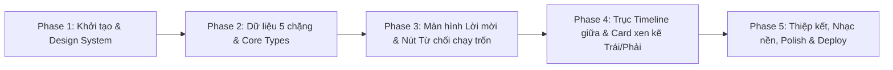

# Kế Hoạch Triển Khai & Phân Rã Công Việc (`PLAN.md`)
## Dự án: Gia Hân's Birthday Dating Invitation (13/12)

---

## Tổng quan lộ trình (Roadmap Overview)

Dự án được chia thành **5 Phase** tuần tự, từ bước khởi tạo nền tảng thiết kế (Design System) đến xây dựng màn hình lời mời tương tác, trục Timeline 5 chặng xen kẽ Trái – Phải, và hoàn thiện hiệu ứng đa phương tiện để sẵn sàng gửi cho Gia Hân.

---

## PHASE 1: Khởi tạo Dự án & Thiết lập Design System (Foundation & Editorial Theme)

**Mục tiêu:** Dựng bộ khung ứng dụng React + TypeScript + Vite + Tailwind CSS, cài đặt đầy đủ thư viện animation và cấu hình bảng màu, font chữ theo đúng tinh thần *Romantic Editorial / Minimalist Portfolio*.

### Danh sách Task (Phase 1)

> ✅ **Trạng thái: HOÀN THÀNH (17/11)** — `npm run build` pass (tsc + vite). Ghi chú: `lucide-react@0.450.0` không tồn tại trên npm nên dùng `^0.451.0` (đã cập nhật TECH_ARCHITECTURE.md); thêm `composite: true` vào `tsconfig.app.json`/`tsconfig.node.json` để tương thích TypeScript 5.5 project references. `App.tsx` hiện là màn hình placeholder kiểm tra design system, sẽ được thay ở Phase 3–5.

- [x] **Task 1.1 — Khởi tạo Vite React TypeScript Project**
  - **Mô tả:** Khởi tạo cấu trúc project chuẩn Vite (`react-ts`), cấu hình `tsconfig.json`, `vite.config.ts` và cấu trúc thư mục `src/components`, `src/data`, `src/hooks`, `src/types`, `src/utils`.
  - **Files đầu ra:** `package.json`, `vite.config.ts`, `tsconfig.json`, `index.html`.
- [x] **Task 1.2 — Cài đặt các thư viện cốt lõi (Dependencies)**
  - **Mô tả:** Cài đặt `tailwindcss`, `postcss`, `autoprefixer`, `framer-motion`, `lucide-react`, `canvas-confetti`, và `@types/canvas-confetti`.
  - **Tiêu chí nghiệm thu:** Chạy lệnh build/dev không phát sinh lỗi thiếu package hay lỗi kiểu dữ liệu TypeScript.
- [x] **Task 1.3 — Thiết lập Typography & Bảng màu Romantic Editorial**
  - **Mô tả:**
    - Nhúng Google Fonts hỗ trợ tiếng Việt (`Cormorant Garamond`, `Plus Jakarta Sans`, `JetBrains Mono`) vào `index.html`.
    - Cấu hình `tailwind.config.js` với bảng màu kem ấm (`#FAF6F0`), hồng đất (`#D9778B`), hồng phấn (`#F9E8EC`), chữ nâu espresso (`#2C2220`).
    - Thiết lập `src/index.css` với `overflow-x: hidden`, smooth scrolling và custom scrollbar thanh mảnh.
  - **Files đầu ra:** `index.html`, `tailwind.config.js`, `src/index.css`.

---

## PHASE 2: Xây dựng Mô hình Dữ liệu & Nội dung 5 Chặng Hẹn Hò (Data & Content Layer)

**Mục tiêu:** Định nghĩa đầy đủ kiểu dữ liệu TypeScript và chuẩn bị sẵn toàn bộ nội dung lời mời ngày 13/12, danh sách câu trêu đùa khi bấm "Từ chối", và thông tin chi tiết của 5 chặng (không có giờ cụ thể, có link Google Maps cho Wok of Love Quận 2 và Photogenic Bình Thạnh).

### Danh sách Task (Phase 2)

> ✅ **Trạng thái: HOÀN THÀNH (17/11)** — `tsc -b` pass; dữ liệu 5 chặng đã kiểm tra: đúng thứ tự, lẻ → `left`, chẵn → `right`, chỉ Chặng 02 & 03 có `googleMapsUrl`. Ghi chú: ảnh minh họa là **SVG local tự vẽ theo bảng màu** (`public/images/stop-0X-*.svg`) thay cho `.jpg` để không phụ thuộc link ngoài — có thể thay bằng ảnh thật bất cứ lúc nào chỉ bằng cách đổi `imageUrl` trong `itineraryData.ts`.

- [x] **Task 2.1 — Định nghĩa TypeScript Interfaces (`src/types/itinerary.ts`)**
  - **Mô tả:** Tạo interface `TimelineStop`, `InvitationConfig`, `TimelineSide` (`'left' | 'right'`), và `StopIconType`.
  - **Files đầu ra:** `src/types/itinerary.ts`.
- [x] **Task 2.2 — Biên soạn dữ liệu 5 chặng & nội dung lời mời (`src/data/itineraryData.ts`)**
  - **Mô tả:** Nhập dữ liệu chi tiết cho dịp sinh nhật **Gia Hân (13/12)**:
    1. **Chặng 01 (`left`):** Đón Gia Hân (`STOP 01 • THE PICK-UP`).
    2. **Chặng 02 (`right`):** Ăn tối & Mừng sinh nhật tại **Wok of Love Quận 2** (`STOP 02 • BIRTHDAY DINNER`) + URL Google Maps.
    3. **Chặng 03 (`left`):** Chụp hình Photobooth tại **Photogenic Bình Thạnh — 490D Điện Biên Phủ, Thạnh Mỹ Tây, Hồ Chí Minh 70000, Việt Nam** (`STOP 03 • CAPTURE THE MOMENT`) + URL Google Maps.
    4. **Chặng 04 (`right`):** Dạo phố & Tráng miệng (`STOP 04 • SWEET AFTERGLOW`).
    5. **Chặng 05 (`left`):** Đưa Gia Hân về (`STOP 05 • SAFE & SOUND`).
    - Kèm danh sách 8–10 câu thông điệp dễ thương thay đổi mỗi lần Gia Hân bấm vào nút "Từ chối".
  - **Files đầu ra:** `src/data/itineraryData.ts`.
- [x] **Task 2.3 — Chuẩn bị hình ảnh minh họa chất lượng cao cho 5 chặng**
  - **Mô tả:** Thiết lập bộ ảnh minh họa thẩm mỹ (editorial photography / fallback Unsplash curated URLs hoặc ảnh local trong `public/images/`) cho từng chặng để card hiển thị đẹp ngay lập tức.
  - **Files đầu ra:** `src/data/itineraryData.ts`, `public/images/`.

---

## PHASE 3: Màn hình Lời mời Mở đầu & Cơ chế Nút "Từ chối" Chạy Trốn (Invitation Gate)

**Mục tiêu:** Xây dựng màn hình đầu tiên khi vừa mở web lên: hiển thị lời mời sinh nhật Gia Hân 13/12 cùng 2 nút "Đồng ý" và "Từ chối". Đảm bảo nút "Từ chối" luôn nhảy tới vị trí ngẫu nhiên hợp lệ trong màn hình, còn nút "Đồng ý" bắn pháo giấy và mở ra lịch trình.

### Danh sách Task (Phase 3)

- [ ] **Task 3.1 — Xây dựng Custom Hook `useRunawayPosition` (`src/hooks/useRunawayPosition.ts`)**
  - **Mô tả:**
    - Viết thuật toán sinh tọa độ `(x, y)` ngẫu nhiên trong vùng an toàn của `window.innerWidth` và `window.innerHeight` (trừ kích thước nút và lề an toàn `48px`).
    - Kiểm tra khoảng cách tối thiểu (`>= 150px`) so với vị trí hiện tại để nút nhảy dứt khoát.
    - Kiểm tra chống va chạm (collision detection) để nút "Từ chối" không bao giờ nhảy đè lên nút "Đồng ý".
    - Tự động reset về vùng an toàn nếu người dùng thay đổi kích thước cửa sổ trình duyệt (`resize` listener).
  - **Files đầu ra:** `src/hooks/useRunawayPosition.ts`.
- [ ] **Task 3.2 — Xây dựng Component `RunawayButton` (`src/components/invitation/RunawayButton.tsx`)**
  - **Mô tả:**
    - Sử dụng `<motion.button>` của Framer Motion với cấu hình lò xo (`type: 'spring', stiffness: 380, damping: 22`).
    - Kích hoạt nhảy vị trí ngay khi người dùng bấm (`onClick`) hoặc rê chuột vào (`onMouseEnter` trên Desktop).
    - Đếm số lần bấm/né để hiển thị các câu trêu đùa vui nhộn và làm nút "Đồng ý" nổi bật dần lên.
  - **Files đầu ra:** `src/components/invitation/RunawayButton.tsx`.
- [ ] **Task 3.3 — Xây dựngTiện ích Pháo giấy & Tim bay (`src/utils/confetti.ts`)**
  - **Mô tả:** Tạo hàm `triggerBirthdayConfetti()` sử dụng `canvas-confetti` bắn pháo giấy hai bên màn hình với bảng màu `#D9778B`, `#F4D5DC`, `#FFD166`, `#FFFFFF`.
  - **Files đầu ra:** `src/utils/confetti.ts`.
- [ ] **Task 3.4 — Xây dựng Màn hình `InvitationGate` (`src/components/invitation/InvitationGate.tsx`)**
  - **Mô tả:**
    - Thiết kế giao diện bìa lời mời kiểu tạp chí/portfolio với khung viền mảnh tinh tế, badge `13.12 • BIRTHDAY INVITATION`, tiêu đề lớn dành cho Gia Hân và 2 nút hành động.
    - Kết nối sự kiện bấm nút **"Đồng ý"** -> gọi `triggerBirthdayConfetti()` -> chuyển cảnh sang màn hình Timeline.
  - **Files đầu ra:** `src/components/invitation/InvitationGate.tsx`.

---

## PHASE 4: Trục Timeline ở Giữa & Hệ thống Card Xen Kẽ Trái – Phải (Alternating Portfolio Timeline)

**Mục tiêu:** Hiển thị lịch trình 5 chặng sau khi bấm "Đồng ý" với một cột dọc chạy từ trên xuống dưới ở chính giữa và các Card thông tin nằm xen kẽ bên trái – bên phải.

### Danh sách Task (Phase 4)

- [ ] **Task 4.1 — Xây dựng Header của trang Lịch trình (`src/components/layout/PortfolioHeader.tsx`)**
  - **Mô tả:** Thiết kế phần mở đầu trang Timeline mang phong cách Portfolio cá nhân: tiêu đề *"Gia Hân's 13.12 Itinerary"*, dòng giới thiệu ngắn gọn rằng buổi hẹn không gò bó giờ giấc, kèm chỉ dẫn cuộn xuống (`Scroll to explore`).
  - **Files đầu ra:** `src/components/layout/PortfolioHeader.tsx`.
- [ ] **Task 4.2 — Xây dựng Trục dọc giữa & Điểm nút (`TimelineSpine.tsx` & `TimelineNode.tsx`)**
  - **Mô tả:**
    - Tạo đường kẻ dọc ở chính giữa màn hình (`left-1/2 -translate-x-1/2`).
    - Áp dụng `useScroll` và `useSpring` của Framer Motion để vẽ đường thẳng màu hồng rose chạy từ trên xuống dưới theo vị trí cuộn trang.
    - Tạo `TimelineNode` nằm trên trục giữa ứng với mỗi chặng, hiển thị icon riêng của chặng đó và hiệu ứng phát sáng khi cuộn tới.
  - **Files đầu ra:** `src/components/timeline/TimelineSpine.tsx`, `src/components/timeline/TimelineNode.tsx`.
- [ ] **Task 4.3 — Xây dựng Component `TimelineCard` (`src/components/timeline/TimelineCard.tsx`)**
  - **Mô tả:**
    - Thiết kế Card theo chuẩn Portfolio: ảnh minh họa bo góc, nhãn `STOP 01..05` + Tag chủ đề, tiêu đề hoạt động, lời nhắn ngọt ngào.
    - Hiển thị khối địa chỉ nổi bật và nút **"Xem trên Google Maps ↗"** cho **Wok of Love Quận 2** (Chặng 2) và **Photogenic Bình Thạnh - 490D Điện Biên Phủ** (Chặng 3).
    - Thêm hiệu ứng xuất hiện (`initial={{ opacity: 0, x: side === 'left' ? -50 : 50 }} whileInView={{ opacity: 1, x: 0 }}`).
  - **Files đầu ra:** `src/components/timeline/TimelineCard.tsx`.
- [ ] **Task 4.4 — Lắp ráp Bố cục Xen kẽ Trái – Phải (`src/components/timeline/TimelineSection.tsx`)**
  - **Mô tả:**
    - Dựng lưới CSS Grid 3 cột (`grid-cols-[1fr_80px_1fr]`) cho Desktop để đặt Chặng 1, 3, 5 ở cột Trái và Chặng 2, 4 ở cột Phải, đối xứng qua trục giữa.
    - Ở phần không gian đối diện mỗi Card trên Desktop, thêm số thứ tự nghệ thuật kích thước lớn mờ (`01`..`05`) và nhãn phụ để trang trông giống một cuốn Lookbook/Portfolio thực thụ.
    - Hỗ trợ fallback gọn đẹp nếu cửa sổ bị thu hẹp.
  - **Files đầu ra:** `src/components/timeline/TimelineSection.tsx`.

---

## PHASE 5: Thiệp Chúc Mừng Cuối Trang, Âm Thanh & Hoàn Thiện (Finale, Polish & Verification)

**Mục tiêu:** Hoàn thiện phần kết thúc cảm xúc ở cuối trục timeline, tích hợp điều khiển nhạc nền, ghép nối toàn bộ luồng trong `App.tsx` và kiểm thử kỹ lưỡng.

### Danh sách Task (Phase 5)

- [ ] **Task 5.1 — Xây dựng Section Kết trang (`src/components/layout/BirthdayFinale.tsx`)**
  - **Mô tả:** Đặt ở điểm kết thúc của trục Timeline: hiển thị tấm thiệp chúc mừng sinh nhật Gia Hân (13/12), lời nhắn hẹn gặp mặt, và nút *"Bắn pháo hoa ăn mừng lần nữa 🎉"*.
  - **Files đầu ra:** `src/components/layout/BirthdayFinale.tsx`.
- [ ] **Task 5.2 — Xây dựng Nút Điều khiển Nhạc nền (`src/components/layout/FloatingAudio.tsx`)**
  - **Mô tả:** Nút nổi thanh lịch ở góc dưới bên phải màn hình, cho phép bật/tắt giai điệu nhạc nền lãng mạn kèm hiệu ứng sóng nhạc/đĩa xoay nhẹ khi đang phát.
  - **Files đầu ra:** `src/components/layout/FloatingAudio.tsx`.
- [ ] **Task 5.3 — Tích hợp Luồng chính trong `App.tsx` (`src/App.tsx`)**
  - **Mô tả:** Sử dụng `<AnimatePresence mode="wait">` của Framer Motion để chuyển đổi mượt mà giữa màn hình `InvitationGate` (trước khi bấm Đồng ý) và màn hình `TimelineView` (sau khi bấm Đồng ý), tự động cuộn lên đầu trang khi mở khóa lịch trình.
  - **Files đầu ra:** `src/App.tsx`.
- [ ] **Task 5.4 — Kiểm thử Chất lượng (QA & Verification)**
  - **Mô tả:**
    - Kiểm tra nút **"Từ chối"** bấm liên tục 20 lần trên màn hình Desktop: luôn nhảy mượt, không bao giờ tràn khỏi khung nhìn, không đè lên nút "Đồng ý".
    - Kiểm tra nút **"Đồng ý"**: nổ confetti mượt và chuyển sang trang Timeline.
    - Kiểm tra **5 chặng Timeline**: đúng thứ tự (*Đón Gia Hân -> Wok of Love Q2 -> Photogenic Bình Thạnh -> Dạo phố/Tráng miệng -> Đưa về*), không có giờ cụ thể, xen kẽ Trái – Phải quanh trục giữa, link Google Maps mở đúng địa chỉ.
    - Chạy `npm run build` đảm bảo không có lỗi TypeScript hay CSS.

