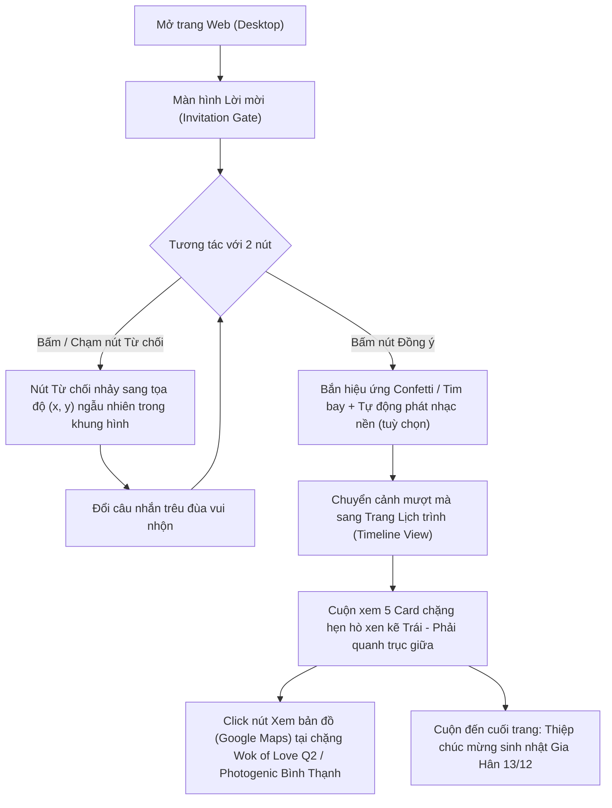

# Product Requirements Document (PRD)
## Dự án: Gia Hân's Birthday Dating Invitation (13/12)

---

## 1. Tổng quan sản phẩm (Product Overview)
- **Tên dự án:** Gia Hân's Birthday Dating Invitation (`dating-invitation`)
- **Dịp đặc biệt:** Sinh nhật Gia Hân — **13/12**
- **Ý tưởng cốt lõi:** Một ứng dụng web tương tác (Interactive Web Application) được thiết kế theo phong cách **Romantic Editorial / Minimalist Portfolio** (tương tự một trang creative portfolio cá nhân kết hợp tạp chí thời trang/ẩm thực lãng mạn). Trang web đóng vai trò là tấm thiệp mời hẹn hò kỹ thuật số dành riêng cho Gia Hân: mở đầu bằng màn hình lời mời tinh nghịch (nút "Từ chối" luôn chạy trốn, chỉ khi bấm "Đồng ý" mới mở khóa nội dung), sau đó dẫn dắt vào một trục **Timeline dọc ở chính giữa** với **5 chặng hành trình xen kẽ hai bên trái – phải** mà không bị gò bó bởi mốc giờ cụ thể.

---

## 2. Mục tiêu & Đối tượng người dùng (Goals & Target User)

### 2.1. Đối tượng người dùng (Target User)
- **Người nhận chính:** Gia Hân.
- **Thiết bị trải nghiệm ưu tiên:** **Máy tính (Desktop / Laptop)** — tối ưu hóa mạnh nhất cho không gian màn hình rộng để phô diễn trọn vẹn bố cục trục giữa + card hai bên trái/phải và hiệu ứng di chuột (hover/click), đồng thời vẫn giữ khả năng hiển thị gọn gàng nếu mở trên màn hình nhỏ hơn.

### 2.2. Mục tiêu trải nghiệm (Experience Goals)
1. **Tạo bất ngờ & niềm vui ngay từ giây đầu tiên:** Cơ chế nút "Từ chối" dịch chuyển tới vị trí ngẫu nhiên mỗi khi bấm/tương tác mang lại tiếng cười và sự thích thú.
2. **Thẩm mỹ tinh tế như một Portfolio cao cấp:** Sử dụng bảng màu kem ấm (Warm Cream) và hồng phấn nhẹ (Blush Rose), kết hợp font chữ Serif thanh lịch hỗ trợ đầy đủ tiếng Việt cùng hiệu ứng chuyển động mượt mà.
3. **Truyền tải lịch trình rõ ràng, tự nhiên:** Không đặt nặng giờ giấc cụ thể (không hiển thị `18:00`, `20:00`...), chỉ tập trung vào chuỗi trải nghiệm liền mạch qua 5 chặng trong ngày sinh nhật 13/12.

---

## 3. Phong cách thiết kế (Design Direction & Aesthetic)

- **Chủ đề (Theme):** *Romantic Editorial / Minimalist Portfolio*
- **Bảng màu chủ đạo (Color Palette):**
  - **Background Primary:** `#FAF6F0` (Warm Alabaster / Kem ấm)
  - **Background Secondary / Card Surface:** `#FFFFFF` (Trắng tinh) kết hợp viền mảnh `#F0E4DF`
  - **Accent Primary:** `#D9778B` (Muted Rose / Hồng đất lãng mạn)
  - **Accent Secondary:** `#F4D5DC` (Soft Blush / Hồng pastel dịu)
  - **Text Primary:** `#2C2220` (Deep Espresso / Đen nâu ấm, dễ đọc hơn đen tuyền)
  - **Text Secondary / Muted:** `#7A6A66` (Warm Taupe)
- **Typography (Hỗ trợ đầy đủ dấu tiếng Việt):**
  - **Heading / Editorial Serif:** `Cormorant Garamond` hoặc `Playfair Display` (tạo cảm giác bìa tạp chí/portfolio nghệ thuật).
  - **Body / UI Sans-serif:** `Plus Jakarta Sans` hoặc `Be Vietnam Pro` (hiện đại, rõ nét trên các mô tả và nút bấm).
  - **Monospace / Tag Label:** `JetBrains Mono` hoặc chữ in hoa giãn cách (`tracking-widest`) cho các nhãn `STOP 01`, `13.12 • BIRTHDAY EDITION`.

---

## 4. Luồng người dùng & Yêu cầu chức năng (User Flow & Functional Requirements)

### 4.1. Tính năng 1: Màn hình Lời mời mở đầu (Invitation Gate / Hero Screen)
- **Nội dung hiển thị:**
  - Badge nhỏ phía trên: `SPECIAL INVITATION • 13.12`
  - Tiêu đề chính: Lời mời hẹn hò mừng sinh nhật **Gia Hân** (ví dụ: *"Gia Hân ơi, ngày 13/12 này đi đón sinh nhật cùng mình nhé?"*).
  - Lời dẫn ngắn gọn, ngọt ngào dưới tiêu đề.
  - Khu vực nút hành động gồm 2 nút đặt cạnh nhau ở trạng thái ban đầu:
    1. **Nút "Đồng ý" (Primary CTA):** Nổi bật, có hiệu ứng nhịp đập nhẹ hoặc đổ bóng ấm áp.
    2. **Nút "Từ chối" (Evasive Secondary Button):** Thiết kế tối giản.
- **Logic nút "Từ chối" chạy trốn:**
  - Khi người dùng **bấm vào** (và có thể hỗ trợ thêm khi di chuột sát vào trên Desktop), nút "Từ chối" không thực hiện lệnh từ chối mà lập tức tính toán một vị trí `(x, y)` ngẫu nhiên mới trong vùng an toàn của màn hình (`viewport`).
  - **Ràng buộc kỹ thuật:**
    - Vị trí mới luôn cách mép màn hình tối thiểu `40px` (không bao giờ bị tràn hoặc mất hút khỏi màn hình).
    - Vị trí mới phải cách vị trí cũ một khoảng tối thiểu (ví dụ `>= 120px`) để thấy rõ sự dịch chuyển.
    - Không được đè lên nút "Đồng ý".
    - Mỗi lần nhảy vị trí, nội dung chữ trên nút hoặc dòng chú thích nhỏ có thể đổi ngẫu nhiên (ví dụ: *"Từ chối" -> "Ơ kìa bấm nhầm rồi!" -> "Nút này đang bảo trì nha" -> "Thử bấm Đồng ý bên kia kìa!"*).
- **Logic nút "Đồng ý":**
  - Khi bấm vào:
    1. Kích hoạt pháo giấy chúc mừng (`canvas-confetti` với tông màu hồng pastel, vàng gold, trắng kem).
    2. Chuyển trạng thái ứng dụng từ `INVITATION_GATE` sang `TIMELINE_REVEALED` với hiệu ứng chuyển cảnh mượt mà (`Framer Motion AnimatePresence`).
    3. Khởi chạy nhạc nền nhẹ nhàng (nếu trình duyệt cho phép sau thao tác click của người dùng).

---

### 4.2. Tính năng 2: Trục Timeline ở giữa & 5 Card xen kẽ Trái – Phải (Alternating Portfolio Timeline)
- **Đặc điểm cốt lõi:**
  - **Không hiển thị giờ giấc cụ thể:** Không dùng `18:00`, `19:30`... Thay vào đó dùng nhãn thứ tự mang phong cách Portfolio như `CHẶNG 01`, `CHẶNG 02`... kèm Tag chủ đề (`PICK UP`, `BIRTHDAY DINNER`, `PHOTOBOOTH`, `STROLL & DESSERT`, `SWEET HOME`).
  - **Cột trục dọc ở chính giữa (Center Spine):**
    - Một đường thẳng dọc chạy xuyên suốt từ chặng 1 đến chặng 5 ngay chính giữa màn hình.
    - Có hiệu ứng đường kẻ được tô màu dần từ trên xuống dưới theo tiến độ cuộn chuột của người dùng (Scroll Progress Line).
    - Tại vị trí kết nối với mỗi Card, trên trục giữa có một điểm nút (Node/Dot kèm Icon nhỏ) phát sáng khi người dùng cuộn tới.
  - **Bố cục xen kẽ Trái – Phải (Alternating Left/Right Cards):**
    - Chặng lẻ (Chặng 1, 3, 5) nằm ở **bên Trái** trục giữa.
    - Chặng chẵn (Chặng 2, 4) nằm ở **bên Phải** trục giữa.
    - Mỗi Card xuất hiện với hiệu ứng trượt nhẹ từ phía tương ứng vào trung tâm và rõ dần (`fade-in + slide-in`) khi cuộn tới.

- **Chi tiết nội dung 5 Chặng (5 Timeline Stops):**

| Thứ tự | Vị trí Card | Tên chặng & Tag | Nội dung & Địa điểm | Hành động / Link |
| :--- | :--- | :--- | :--- | :--- |
| **Chặng 01** | **Bên Trái** | **Đón Gia Hân** `STOP 01 • THE PICK-UP` | Khởi đầu ngày sinh nhật 13/12. Qua đón nhân vật chính của ngày hôm nay, sẵn sàng lên đồ thật xinh để bắt đầu hành trình. | Không cần link bản đồ |
| **Chặng 02** | **Bên Phải** | **Ăn tối & Mừng sinh nhật** `STOP 02 • BIRTHDAY DINNER` | **Địa điểm:** **Wok of Love — Quận 2** Thưởng thức bữa tối ấm cúng, ngon miệng và cùng nhau thổi nến mừng tuổi mới của Gia Hân. | Nút **"Xem trên Google Maps"** mở tab mới tới Wok of Love Quận 2 |
| **Chặng 03** | **Bên Trái** | **Chụp hình Photobooth** `STOP 03 • CAPTURE THE MOMENT` | **Địa điểm:** **Photogenic Bình Thạnh** *490D Điện Biên Phủ, Thạnh Mỹ Tây, Hồ Chí Minh 70000, Việt Nam* Cùng tạo dáng và lưu giữ những tấm hình photobooth kỷ niệm ngày sinh nhật 13/12. | Nút **"Xem trên Google Maps"** mở tab mới tới đúng địa chỉ `490D Điện Biên Phủ, Bình Thạnh` |
| **Chặng 04** | **Bên Phải** | **Dạo phố & Tráng miệng** `STOP 04 • SWEET AFTERGLOW` | Cùng nhau đi dạo hóng gió, thưởng thức một món tráng miệng ngọt ngào và trò chuyện thư giãn. | Không bắt buộc link cố định |
| **Chặng 05** | **Bên Trái** | **Đưa Gia Hân về** `STOP 05 • SAFE & SOUND` | Đưa công chúa về tận nhà an toàn, khép lại buổi hẹn sinh nhật 13/12 trọn vẹn và ấm áp. | Không cần link bản đồ |

- **Thành phần bên trong mỗi Timeline Card:**
  1. **Header Card:** Tag số thứ tự (`STOP 01`...`STOP 05`) + Icon chủ đề (Xe đón, Nhà hàng/Bánh sinh nhật, Máy ảnh, Kem/Trà, Ngôi nhà/Trái tim).
  2. **Hình ảnh minh họa (Editorial Cover Image):** Khung ảnh bo góc mềm mại, có hiệu ứng zoom nhẹ (`scale-105`) khi di chuột qua card.
  3. **Tiêu đề chặng & Địa điểm nổi bật:** Tên hoạt động + khối hiển thị địa chỉ (nếu có).
  4. **Lời nhắn / Mô tả ngắn:** Giọng văn gần gũi, dễ thương dành cho Gia Hân.
  5. **Nút Google Maps (chỉ hiển thị ở các chặng có địa điểm cụ thể như Chặng 02 và Chặng 03):** Mở link Google Maps trong tab mới (`target="_blank" rel="noopener noreferrer"`).

---

### 4.3. Tính năng 3: Phần kết Thiệp chúc mừng & Tiện ích bổ trợ (Birthday Finale & Audio)
- **Section kết thúc ở cuối trục Timeline:**
  - Một tấm thiệp nhỏ mang phong cách thư tay / editorial note gửi lời chúc mừng sinh nhật tuổi mới ngày **13/12** tới Gia Hân.
  - Nút tương tác nhỏ *"Bắn pháo hoa lần nữa 🎉"* để Gia Hân có thể bấm chơi lại hiệu ứng confetti bất cứ lúc nào.
- **Trình điều khiển nhạc nền (Floating Music Toggle):**
  - Nút tròn nhỏ cố định ở góc dưới bên phải màn hình sau khi đã vào trang Timeline, cho phép bật/tắt nhạc nền nhẹ nhàng.

---

## 5. Yêu cầu phi chức năng (Non-Functional Requirements)
1. **Hiệu năng & Độ mượt:** Mọi chuyển động (nút nhảy, chuyển trang, cuộn timeline) đạt 60fps nhờ sử dụng GPU-accelerated properties (`transform`, `opacity`) qua `Framer Motion`.
2. **Độ tin cậy của giao diện:** Nút "Từ chối" tuyệt đối không bao giờ nhảy ra ngoài rìa màn hình hoặc gây xuất hiện thanh cuộn ngang (`overflow-x: hidden`).
3. **Không phụ thuộc Backend:** Hoạt động 100% ở phía Client (Static SPA), tải nhanh tức thì và dễ dàng triển khai miễn phí trên Vercel, Netlify hoặc GitHub Pages.

---

## 6. Giới hạn phạm vi (Out of Scope)
- Không xây dựng hệ thống Backend, cơ sở dữ liệu hay đăng nhập.
- Không gửi thông báo thời gian thực (Email/Telegram/Webhook) khi người nhận bấm nút.
- Không gắn mốc thời gian giờ/phút cụ thể (`HH:mm`) vào các chặng trên timeline.
- Không nhúng bản đồ Google Maps dạng `<iframe>` trực tiếp vào từng card để giữ giao diện thanh thoát đúng chất Portfolio (thay bằng nút mở Google Maps trực tiếp).

