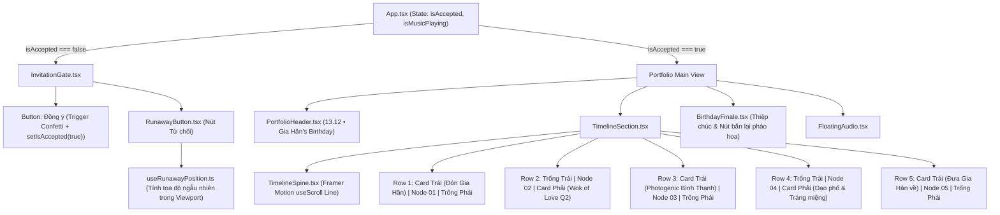

# Technical Architecture Document (`TECH_ARCHITECTURE.md`)
## Dự án: Gia Hân's Birthday Dating Invitation (13/12)

---

## 1. Tổng quan Kiến trúc & Tech Stack (Technology Stack)

Dự án được xây dựng dưới dạng **Single Page Application (SPA) thuần Frontend (Static Web App)**, tập trung tối đa vào trải nghiệm thị giác (Editorial Portfolio UI), tương tác vật lý mượt mà (Spring Physics) và tốc độ phản hồi tức thì trên trình duyệt Desktop/Laptop.

| Tầng (Layer) | Công nghệ lựa chọn | Phiên bản đề xuất | Lý do lựa chọn |
| :--- | :--- | :--- | :--- |
| **Core Framework** | **React + TypeScript** | React `^18.3.0` / TS `^5.5.0` | Kiến trúc component rõ ràng, kiểm soát chặt chẽ kiểu dữ liệu của các chặng timeline và tọa độ nút bấm. |
| **Build Tool** | **Vite** | `^5.4.0` | Khởi tạo nhanh, HMR tức thì, bundle gọn nhẹ cho Static SPA. |
| **Styling** | **Tailwind CSS** | `^3.4.0` | Thiết kế nhanh hệ thống lưới (Grid 3 cột cho trục giữa + 2 bên trái/phải), dễ cấu hình bảng màu Romantic Editorial và font chữ. |
| **Animation Engine** | **Framer Motion** | `^11.x` | Xử lý chuyển động lò xo (`spring`) cho nút "Từ chối" nhảy vị trí, hiệu ứng chuyển cảnh (`AnimatePresence`), và hiệu ứng vẽ trục timeline theo cuộn chuột (`useScroll`, `useSpring`). |
| **Visual Effects** | **canvas-confetti** | `^1.9.3` | Tạo hiệu ứng pháo giấy / tim bay mượt mà trên `<canvas>` khi Gia Hân bấm "Đồng ý". |
| **Icons** | **lucide-react** | `^0.450.0` | Bộ icon nét mảnh, thanh lịch, phù hợp hoàn hảo với phong cách Minimalist Portfolio. |
| **Deployment** | **Vercel / Netlify / GitHub Pages** | Static Hosting | Triển khai miễn phí qua Git, tự động tạo link HTTPS chia sẻ ngay cho Gia Hân. |

---

## 2. Cấu trúc thư mục dự án (Project Directory Structure)

```text
dating-invitation/
├── docs/
│   ├── PRD.md                        # Tài liệu yêu cầu sản phẩm
│   ├── TECH_ARCHITECTURE.md          # Tài liệu kiến trúc kỹ thuật
│   └── PLAN.md                       # Kế hoạch triển khai theo từng Phase & Task
├── public/
│   ├── audio/
│   │   └── birthday-bgm.mp3          # Nhạc nền nhẹ nhàng (tuỳ chọn thay thế)
│   └── images/
│       ├── stop-01-pickup.jpg        # Ảnh minh họa Chặng 1: Đón Gia Hân
│       ├── stop-02-wokoflove.jpg     # Ảnh minh họa Chặng 2: Wok of Love Quận 2
│       ├── stop-03-photogenic.jpg    # Ảnh minh họa Chặng 3: Photogenic Bình Thạnh
│       ├── stop-04-dessert.jpg       # Ảnh minh họa Chặng 4: Dạo phố & Tráng miệng
│       └── stop-05-home.jpg          # Ảnh minh họa Chặng 5: Đưa về
├── src/
│   ├── components/
│   │   ├── invitation/
│   │   │   ├── InvitationGate.tsx    # Màn hình lời mời mở đầu (Hero + 2 nút)
│   │   │   └── RunawayButton.tsx     # Nút "Từ chối" tự nhảy sang vị trí ngẫu nhiên
│   │   ├── timeline/
│   │   │   ├── TimelineSection.tsx   # Khung chứa trục dọc giữa + danh sách 5 chặng
│   │   │   ├── TimelineSpine.tsx     # Đường kẻ dọc ở chính giữa chạy từ trên xuống
│   │   │   ├── TimelineNode.tsx      # Điểm nút tròn + icon nằm trên trục giữa
│   │   │   └── TimelineCard.tsx      # Card chi tiết từng chặng (căn Trái hoặc Phải)
│   │   ├── layout/
│   │   │   ├── PortfolioHeader.tsx   # Header mỏng kiểu Editorial ("GIA HÂN • 13.12")
│   │   │   ├── BirthdayFinale.tsx    # Thiệp chúc mừng sinh nhật ở cuối trục timeline
│   │   │   └── FloatingAudio.tsx     # Nút bật/tắt nhạc nền góc dưới màn hình
│   │   └── ui/
│   │       └── Badge.tsx             # Component nhãn trang trí nhỏ kiểu tạp chí
│   ├── data/
│   │   └── itineraryData.ts          # Dữ liệu tĩnh 5 chặng hẹn hò & câu thoại nút Từ chối
│   ├── hooks/
│   │   └── useRunawayPosition.ts     # Custom hook tính toán tọa độ (x, y) ngẫu nhiên an toàn
│   ├── types/
│   │   └── itinerary.ts              # Khai báo TypeScript Interfaces
│   ├── utils/
│   │   └── confetti.ts               # Hàm bắn pháo giấy / trái tim chúc mừng
│   ├── App.tsx                       # Quản lý state chuyển đổi giữa InvitationGate & Timeline
│   ├── main.tsx                      # Entry point của React
│   └── index.css                     # Cấu hình Tailwind CSS + Google Fonts + Custom Scrollbar
├── index.html
├── package.json
├── tailwind.config.js
├── tsconfig.json
└── vite.config.ts
```

---

## 3. Sơ đồ Kiến trúc Component & Luồng Dữ liệu (Component Hierarchy & State Flow)



---

## 4. Thiết kế Data Model (`src/types/itinerary.ts`)

Không sử dụng trường thời gian (`time`), thay bằng số thứ tự chặng (`stepNumber`), nhãn định danh kiểu portfolio (`categoryTag`) và vị trí hiển thị (`side: 'left' | 'right'`):

```typescript
export type TimelineSide = 'left' | 'right';

export type StopIconType = 'car' | 'utensils' | 'camera' | 'ice-cream' | 'home-heart';

export interface TimelineStop {
  id: string;
  stepNumber: string;          // VD: "01", "02", "03", "04", "05"
  categoryTag: string;         // VD: "THE PICK-UP", "BIRTHDAY DINNER", "PHOTOBOOTH"
  title: string;               // Tên hoạt động chính
  subtitle?: string;           // Phụ đề ngắn lãng mạn
  description: string;         // Lời nhắn / mô tả chi tiết cho Gia Hân
  locationName?: string;       // VD: "Wok of Love - Quận 2" hoặc "Photogenic Bình Thạnh"
  address?: string;            // VD: "490D Điện Biên Phủ, Thạnh Mỹ Tây, Hồ Chí Minh 70000, Việt Nam"
  googleMapsUrl?: string;      // Link mở Google Maps trực tiếp (nếu có địa điểm cụ thể)
  imageUrl: string;            // Đường dẫn ảnh minh họa
  imageAlt: string;            // Mô tả ảnh
  icon: StopIconType;          // Icon hiển thị trên trục giữa & góc card
  side: TimelineSide;          // 'left' cho chặng lẻ (1,3,5), 'right' cho chặng chẵn (2,4)
}

export interface InvitationConfig {
  recipientName: string;       // "Gia Hân"
  occasionDate: string;        // "13 / 12"
  occasionTitle: string;       // "Birthday Date Invitation"
  heroHeadline: string;        // Lời mời chính ở màn hình đầu
  heroSubtext: string;         // Lời nhắn phụ dưới tiêu đề
  evasiveMessages: string[];   // Danh sách câu trêu đùa khi bấm nút "Từ chối"
}
```

---

## 5. Thiết kế Kỹ thuật cho 2 Cơ chế Trọng tâm

### 5.1. Thuật toán Nút "Từ chối" nhảy vị trí ngẫu nhiên (`useRunawayPosition.ts`)

**Bài toán:** Khi Gia Hân bấm vào nút "Từ chối" (hoặc đưa chuột vào nút trên Desktop), nút phải nhảy ngay lập tức sang một vị trí bất kỳ khác trên màn hình nhưng:
1. Không bao giờ nhảy ra ngoài khung nhìn trình duyệt (`window.innerWidth`, `window.innerHeight`).
2. Không nhảy một quãng quá ngắn khiến người dùng tưởng nút đứng yên (cần khoảng cách tối thiểu `MIN_DISTANCE = 150px`).
3. Không nhảy đè lên vùng diện tích của nút **"Đồng ý"** (`acceptButtonRef`).

**Giải pháp kỹ thuật:**
- Ở trạng thái khởi tạo (`hasMoved = false`), nút "Từ chối" đứng yên lịch sự bên cạnh nút "Đồng ý" trong bố cục Flexbox trung tâm.
- Ngay khi sự kiện `onClick` (và `onMouseEnter` tùy chọn cấu hình) kích hoạt:
  - Đổi trạng thái `hasMoved = true`, chuyển nút sang `position: fixed` với tọa độ `(x, y)` tính bằng pixel theo `viewport`.
  - Lấy kích thước thực tế của nút (`btnWidth`, `btnHeight`) và vùng an toàn `SAFE_PADDING = 48` (px).
  - Không gian hợp lệ:
    - `minX = SAFE_PADDING`, `maxX = window.innerWidth - btnWidth - SAFE_PADDING`
    - `minY = SAFE_PADDING`, `maxY = window.innerHeight - btnHeight - SAFE_PADDING`
  - Vòng lặp lấy mẫu (tối đa 20 lần thử) chọn cặp `(nextX, nextY)` sao cho:
    - Khoảng cách Euclid từ vị trí hiện tại tới `(nextX, nextY)` lớn hơn `150px`.
    - Hình chữ nhật của nút tại `(nextX, nextY)` không giao cắt (bounding-box collision check) với hình chữ nhật của nút **"Đồng ý"** (cộng thêm khoảng đệm `24px`).
  - Dùng `<motion.button animate={{ left: pos.x, top: pos.y }} transition={{ type: "spring", stiffness: 380, damping: 22 }} />` của **Framer Motion** để nút lướt sang vị trí mới cực kỳ mượt và tự nhiên.

---

### 5.2. Kiến trúc Bố cục Trục Timeline ở giữa & Card xen kẽ Trái – Phải (`TimelineSection.tsx`)

**Bài toán:** Thiết kế một cột trục dọc chạy xuyên suốt ở chính giữa từ trên xuống dưới, các card hoạt động nằm xen kẽ bên trái và bên phải, kết nối trực quan với trục giữa.

**Giải pháp CSS Grid 3 Cột trên Desktop:**
- Container chính của mỗi hàng chặng (`TimelineRow`) sử dụng cấu trúc Grid 3 cột đối xứng:
  ```css
  /* Tailwind: grid grid-cols-[1fr_80px_1fr] items-center gap-6 max-w-6xl mx-auto */
  ```
  - **Cột 1 (`1fr` - Bên Trái):**
    - Nếu `stop.side === 'left'`: Render `<TimelineCard />` căn sát về phía trục giữa (`justify-self-end text-left`), kèm một đường gạch ngang mảnh nối từ cạnh phải của Card vào Node ở cột 2.
    - Nếu `stop.side === 'right'`: Để trống (hoặc hiển thị chữ watermark số thứ tự mờ `02`, `04` kiểu tạp chí portfolio để bố cục cân đối và nghệ thuật).
  - **Cột 2 (`80px` - Trục Giữa):**
    - Chứa **Đường trục dọc xuyên suốt (`TimelineSpine`)**: Gồm 1 đường nền màu kem đậm (`bg-rose-200/70 w-[2px]`) và 1 đường phủ màu hồng đất (`bg-[#D9778B] w-[2px] origin-top`) có `scaleY` gắn trực tiếp với `useScroll` + `useSpring` của Framer Motion.
    - Chứa **Điểm nút (`TimelineNode`)**: Vòng tròn ở chính giữa hàng, bên trong là icon của chặng đó.
  - **Cột 3 (`1fr` - Bên Phải):**
    - Nếu `stop.side === 'right'`: Render `<TimelineCard />` căn sát về phía trục giữa (`justify-self-start`), kèm đường gạch ngang nối vào Node.
    - Nếu `stop.side === 'left'`: Để trống (hoặc hiển thị watermark số thứ tự mờ `01`, `03`, `05`).

```text
          CỘT TRÁI (1fr)                TRỤC GIỮA (80px)               CỘT PHẢI (1fr)
                                               │
   ┌───────────────────────────┐               │
   │ CHẶNG 01: Đón Gia Hân     │──────────────(🚗)                    01 • THE PICK-UP
   └───────────────────────────┘               │
                                               │
                                               │               ┌───────────────────────────┐
            02 • BIRTHDAY DINNER              (🍽️)─────────────│ CHẶNG 02: Wok of Love Q2  │
                                               │               │ [Xem trên Google Maps ↗]  │
                                               │               └───────────────────────────┘
   ┌───────────────────────────┐               │
   │ CHẶNG 03: Photogenic BT   │──────────────(📸)                    03 • PHOTOBOOTH
   │ 490D Điện Biên Phủ        │               │
   │ [Xem trên Google Maps ↗]  │               │
   └───────────────────────────┘               │
                                               │               ┌───────────────────────────┐
            04 • SWEET AFTERGLOW              (🍦)─────────────│ CHẶNG 04: Dạo phố &       │
                                               │               │ Tráng miệng               │
                                               │               └───────────────────────────┘
   ┌───────────────────────────┐               │
   │ CHẶNG 05: Đưa Gia Hân về  │──────────────(🏠)                    05 • SAFE & SOUND
   └───────────────────────────┘               │
                                               ▼
```

---

## 6. Cấu hình Đường dẫn Google Maps Chính xác

Hai chặng có địa điểm thực tế sẽ được gắn sẵn URL chuẩn xác trong `src/data/itineraryData.ts`:
1. **Chặng 02 — Wok of Love (Quận 2):**
   - URL tìm kiếm chuẩn: `https://www.google.com/maps/search/?api=1&query=Wok+of+Love+Quan+2+Ho+Chi+Minh`
2. **Chặng 03 — Photogenic Bình Thạnh:**
   - Địa chỉ hiển thị: `490D Điện Biên Phủ, Thạnh Mỹ Tây, Hồ Chí Minh 70000, Việt Nam`
   - URL tìm kiếm chuẩn: `https://www.google.com/maps/search/?api=1&query=Photogenic+Binh+Thanh+490D+Dien+Bien+Phu+Thanh+My+Tay+Ho+Chi+Minh`

---

## 7. Cấu hình Theme & Animations (`tailwind.config.js`)

- **Font Family:**
  - `font-serif`: `['"Cormorant Garamond"', '"Playfair Display"', 'Georgia', 'serif']`
  - `font-sans`: `['"Plus Jakarta Sans"', 'system-ui', 'sans-serif']`
  - `font-mono`: `['"JetBrains Mono"', 'monospace']`
- **Custom Colors:**
  - `cream-50`: `#FDFBF7`
  - `cream-100`: `#FAF6F0`
  - `blush-100`: `#F9E8EC`
  - `blush-300`: `#E8B4C0`
  - `rose-accent`: `#D9778B`
  - `espresso`: `#2C2220`
  - `taupe`: `#7A6A66`

